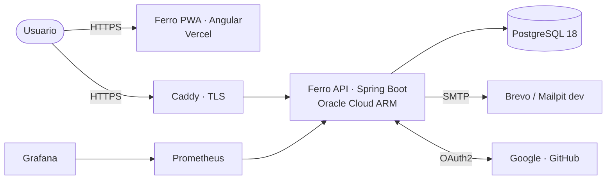

# 🏋️ Ferro — Tracker de entrenamientos de fuerza

> **Ferro** (del latín *ferrum*, hierro): registra tus sesiones de gimnasio, vigila tus
> progresiones y convierte cada serie en datos. Una alternativa open source a
> [Hevy](https://hevyapp.com), construida como proyecto de portfolio de nivel profesional.

[](./docs/07-roadmap.md)
[](./LICENSE)
[](./docs/07-roadmap.md)

---

## ¿Qué es?

Aplicación web multiusuario (PWA) para hacer **tracking de entrenamientos de fuerza e
hipertrofia**: logging de series (reps, peso, RIR), supersets y drop sets, temporizador de
descanso, rutinas reutilizables, historial con récords personales (PRs), estadísticas de
progreso y mediciones corporales. Sin red social: el foco es el dominio.

| Rol | Descripción |
|---|---|
| **Usuario final** | Cualquier persona que entrene con pesas y quiera registrar y analizar su progreso |
| **Reclutador técnico** | Puede leer la documentación, la arquitectura y el código como muestra de ingeniería |

## Stack (decisión cerrada — ver [ADRs](./docs/adr/))

| Capa | Tecnología |
|---|---|
| Frontend | Angular 22 (standalone, signals, zoneless, Signal Forms) · Tailwind CSS 4 · NgRx SignalStore · PWA · Vitest |
| Backend | Java 21 LTS · Spring Boot 4.1 (Framework 7, Jakarta EE 11) · Maven · arquitectura hexagonal + DDD táctico · Spring Modulith |
| API | REST `/api/v1` · OpenAPI 3 (springdoc) · errores RFC 7807 |
| Base de datos | PostgreSQL 18 · Flyway · JPA (escrituras) + SQL nativo (estadísticas) |
| Seguridad | Spring Security · Argon2id · JWT (access + refresh con rotación) · OAuth2 Google/GitHub |
| Tests | JUnit · Mockito · Testcontainers · ArchUnit · Playwright · PIT (mutación) |
| Infra | Docker + Compose · GitHub Actions (CI/CD) · Vercel (frontend) · Oracle Cloud Always Free ARM (backend + BD) · Prometheus + Grafana |

## Arquitectura en una imagen



Monolito modular con seis bounded contexts: `identity`, `catalog`, `training`,
`progress`, `body` y `platform`. Detalle completo en
[docs/04-arquitectura.md](./docs/04-arquitectura.md).

## Documentación

| Documento | Contenido |
|---|---|
| [01 · Visión de producto](./docs/01-vision-producto.md) | Problema, objetivos, personas, alcance IN/OUT, riesgos |
| [02 · Requisitos funcionales](./docs/02-requisitos-funcionales.md) | Historias de usuario con criterios de aceptación y reglas de negocio |
| [03 · Requisitos no funcionales](./docs/03-requisitos-no-funcionales.md) | Rendimiento, seguridad, RGPD, a11y, i18n, observabilidad |
| [04 · Arquitectura](./docs/04-arquitectura.md) | C4, bounded contexts, hexagonal, eventos, despliegue |
| [05 · Modelo de datos](./docs/05-modelo-datos.md) | ER, tablas, índices, enums, seeds |
| [06 · API REST](./docs/06-api-rest.md) | Contrato de endpoints, ejemplos, errores, paginación |
| [07 · Roadmap](./docs/07-roadmap.md) | Milestones M0–M7 (8 semanas) con Definition of Done |
| [08 · Backlog v2](./docs/08-backlog-v2.md) | Funcionalidad deliberadamente fuera del MVP |
| [09 · Glosario](./docs/09-glosario.md) | Lenguaje ubicuo ES↔EN del dominio |
| [AGENTS.md](./AGENTS.md) | Harness: reglas de trabajo, gates y protocolo de evidencia |
| [Lecciones del harness](./docs/harness/lessons.md) | Errores → artefactos que impiden repetirlos |
| [ADR-0001…0009](./docs/adr/) | Decisiones de arquitectura justificadas |

## Estado del proyecto

**📋 Fase de ingeniería de requisitos (noviembre 2026).** El código empieza en el
milestone **M0** (semana 1) siguiendo [docs/07-roadmap.md](./docs/07-roadmap.md).
Nada de lo que hay hoy es ambiguo: cada historia tiene criterios de aceptación y cada
decisión técnica tiene su ADR.

## Desarrollo local y verificación

El harness **no necesita JDK ni Node en el host**: ejecuta versiones fijas en Docker
(Java 21 + Maven 3.9, Node 24). Primera vez en un clon:

```bash
make bootstrap   # diagnóstico del entorno + instalación de git hooks
make verify      # gate completo + bloque de evidencia
```

| Comando | Para qué |
|---|---|
| `make doctor` | Comprueba Docker, hooks, cachés, red y puertos |
| `make fmt` | Aplica Spotless (Java) y Prettier (Angular) |
| `make test` | Tests unitarios rápidos de backend y frontend |
| `make verify` | **Definition of Done**: backend `mvn clean verify` (tests, Checkstyle, Spotless, ArchUnit, Modulith), frontend (formato, ESLint, Vitest con cobertura, build), gitleaks, enlaces de docs e invariantes del harness |
| `make verify-backend` / `make verify-frontend` | Verificación de una sola parte |

`make verify` sale 0 **solo** si todos los gates pasan, deja la evidencia en
`.harness/last-verify.txt` y la imprime. El protocolo completo (reglas anti-victoria
prematura, lessons learned y cómo añadir gates) está en [AGENTS.md](./AGENTS.md).

```bash
# Servicios de desarrollo (se añaden en M0; aún no existen)
docker compose -f infra/docker-compose.dev.yml up -d
```

Estado actual: documentación v1.0 cerrada y **esqueleto inicial ejecutable** con gates
desde el día 1. M0 sigue en curso: todavía no hay endpoints de negocio ni persistencia.


## Licencia

[MIT](./LICENSE) · © 2026 Ángel ([@angelnr](https://github.com/angelnr))
