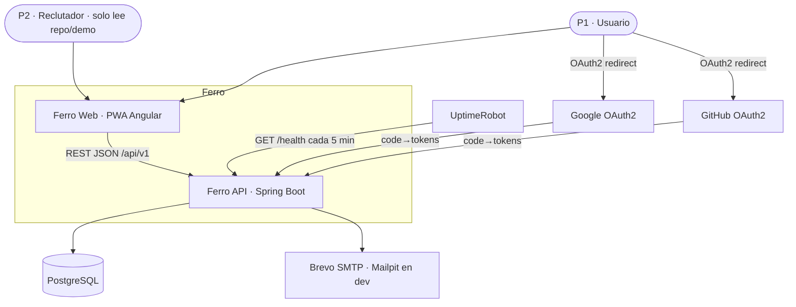
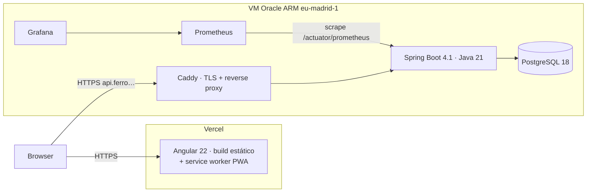
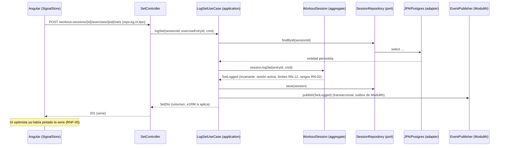

# 04 · Arquitectura

| Versión | 1.0 · 2026-11-09 |
| Decisiones concretas | justificadas en [ADRs](./adr/) — este documento describe el «qué», los ADRs el «por qué» |

## 1 · Estilo general

**Monolito modular** (un solo artefacto Spring Boot desplegable) con **arquitectura
hexagonal por módulo** y **DDD táctico** dentro de cada bounded context. Los módulos se
comunican por su API pública de application services y por **eventos de dominio**
(Spring Modulith, publicación transaccional). Elección justificada en
ADR-0001/0002: máxima señal de ingeniería para el tamaño del proyecto, cero sobrecoste
operativo de repartir en servicios, y camino documentado hacia extracción futura.

## 2 · C4 · Nivel 1 — Contexto



## 3 · C4 · Nivel 2 — Contenedores



- **Frontend**: SPA estática + PWA (service worker de app shell; datos siempre online).
- **API**: contenedor Docker multi-stage (JRE 21) tras Caddy (TLS automático Let's
  Encrypt, HTTP→HTTPS, compresión, cabeceras de seguridad).
- **BD**: contenedor PostgreSQL 18 con volumen dedicado + backups pg_dump.
- **Observabilidad**: Prometheus (scrape 15 s) + Grafana (provisionado por IaC).

## 4 · Módulos (bounded contexts)

| Módulo | Responsabilidad | Agregados (raíz) | Eventos que publica | Eventos que escucha |
|---|---|---|---|---|
| `identity` | cuentas, credenciales, tokens, OAuth, perfil, preferencias | `User` | `UserRegistered`, `EmailVerified`, `PasswordChanged`, `AccountDeleted` | — |
| `catalog` | catálogo global y ejercicios custom | `Exercise` | `CustomExerciseArchived` | — |
| `training` | sesiones en vivo, series, rutinas | `WorkoutSession`, `Routine` | `SessionStarted`, `SetLogged`, `SessionCompleted`, `SessionDiscarded` | `UserRegistered` (crear preferencias por defecto) |
| `progress` | historial, PRs, estadísticas, racha | `PersonalRecord` (derivado) | `PersonalRecordAchieved` | `SessionCompleted`, `SessionDiscarded`, `AccountDeleted` (limpieza) |
| `body` | peso y medidas corporales | `BodyMeasurement` | `BodyMeasurementRecorded` | `AccountDeleted` |
| `platform` | flags, emails, health, métricas, config | — (servicios) | — | `UserRegistered`→bienvenida, `EmailVerified`→?, `PersonalRecordAchieved`→(v2), `SessionCompleted`→auto-cierre email, resumen semanal (cron) |

Reglas de acoplamiento (verificadas por ArchUnit + Modulith, RNF-44):

1. `domain` de un módulo **no importa** nada fuera de su paquete ni de `java.*`/Jakarta.
2. `application` puede usar `domain` del mismo módulo y puertos definidos por él.
3. `infrastructure` e `interfaces` (REST) implementan puertos; nada de `domain` los importa.
4. Un módulo solo accede a otro vía su **API pública** (paquete `api` del módulo destino
   o eventos). Jamás import de `internal`.
5. Sin `@Autowired` de campo; constructor + `@RequiredArgsConstructor` o equivalentes.

## 5 · Estructura de paquetes (por módulo, dentro de un solo artefacto Maven)

```
com.ferro
├── FerroApplication.java          (boot + @Modulith wrapper)
├── shared/                        (kernel mínimo: ValueObject base, DomainEvent,
│   ├── domain/                     utilidades de dominio, errores de dominio comunes)
│   └── application/
├── identity/
│   ├── api/          (public: UserFacade — usado por otros módulos)
│   ├── domain/       (User, Email, PasswordHash, OAuthProvider*, TokenType*…)
│   ├── application/  (RegisterUserUseCase, LoginUseCase, puertos: UserRepository,
│   │                  Clock, PasswordHasher, TokenIssuer, EmailSender…)
│   ├── infrastructure/ (JPA repositories, Argon2, JWT, OAuth clients, MailAdapter)
│   └── interfaces/   (rest: AuthController, UserController + DTOs + mapeadores)
├── catalog/ …
├── training/ …
├── progress/ …
├── body/ …
└── platform/ (config, security, actuator, flags, observabilidad, scheduling)
```

*Nota:* los value objects de identidad como `OAuthProvider` viven en `identity.domain`;
los tipos de serie/tipo de PR/etc. en `training.domain`/`progress.domain`. Código 100 %
en inglés (glosario ES↔EN en doc 09). El paquete `shared` es mínimo deliberadamente:
si algo necesita compartirse masivamente es señal de contexto mal cortado.

## 6 · Ciclo de vida de un caso de uso (ejemplo canónico: registrar serie)



## 7 · Autenticación y seguridad (resumen ejecutivo; detalle ADR-0006)

1. Registro/login → Argon2id + acceso **JWT 15 min** devuelto en el cuerpo (memoria del
   store, jamás localStorage) + **refresh opaco 30 d** en cookie `httpOnly; Secure;
   SameSite=None` del dominio de la API.
2. Silent refresh al arrancar; 401 → refresco → reintento único → logout forzado.
3. OAuth Google/GitHub: Authorization Code + PKCE; el backend canjea el code.
4. Filtro de correlación + rate limit (bucket4j) + CORS allowlist + CSP.
5. Todo recurso es scopeado por `user_id` (IDOR): tests automáticos que intentan
   acceder a recursos ajenos → 404 genérico (no 403, no se revela existencia).

## 8 · Despliegue

### Desarrollo (estación de trabajo)

| Servicio | Dónde | Puerto host (solo 127.0.0.1) |
|---|---|---|
| PostgreSQL 18 | compose | 5432 |
| Mailpit (UI/SMTP) | compose | 8025 / 1025 |
| Prometheus | compose | 9090 |
| Grafana | compose | **3003** ← puerto registrado de Ferro en `PUERTOS.md` |
| API | `mvn spring-boot:run` (host) | 8080 |
| Frontend | `ng serve` (host) | 4200 |

`infra/docker-compose.dev.yml` levanta los cuatro primeros con un comando. Datos
dev en volúmenes efímeros. `.env` con secretos locales (`.env.example` documentado).

### Producción (Oracle Always Free · eu-madrid-1 · VM.Standard.A1.Flex 2 OCPU/12 GB)

| Elemento | Detalle |
|---|---|
| DNS | `ferro-api.duckdns.org` → IP pública VM (DuckDNS, gratuito) |
| Edge | Caddy (TLS ACME automático, HTTP→HTTPS) |
| App | `docker compose -f infra/docker-compose.prod.yml` (api, postgres, prometheus, grafana, caddy) con `restart: unless-stopped` |
| Imagen | GitHub Actions → GHCR `ghcr.io/angelnr/ferro-api:latest` + `:sha` |
| Deploy | Actions SSH → `docker compose pull && up -d` (runbook en M7) |
| Frontend | Vercel (auto-deploy de `frontend/`, previews por PR) |
| Backups | cron `pg_dump` diario (retención 7) + semanal a Object Storage (retención 4) |
| Monitor externo | UptimeRobot → `/actuator/health/liveness` cada 5 min → email (mitiga idle-reclaim) |
| Acceso Grafana | SSH tunnel (no público) |

Mitigación de riesgos Oracle documentada en ADR-0004 (idle-reclaim, capacidad ARM,
plan B Hetzner). El frontend en Vercel: `ferro.vercel.app`.

## 9 · Observabilidad

- **Métricas negocio**: `ferro_sessions_started_total`, `ferro_sets_logged_total`,
  `ferro_sessions_finished_total`, `ferro_prs_total{type}`, `ferro_emails_sent_total{template,result}`,
  `ferro_login_total{result}`, `ferro_oauth_login_total{provider}`.
- **Técnicas**: http.server.requests (p95 por uri), hikari, jvm, process, flyway.
- **Dashboard Grafana** (provisionado): overview (rps, latencia p95, errores),
  negocio, JVM/pool, Postgres (exporter opcional en v2).
- **Logs**: JSON → stdout → `docker logs`/journal; correlación por `correlationId`.

## 10 · Decisiones registradas (índice)

ADR-0001 monolito modular vs microservicios · 0002 DDD táctico + hexagonal + Modulith ·
0003 stack y versiones · 0004 hosting y despliegue · 0005 persistencia y lecturas ·
0006 autenticación (JWT + OAuth + cookies) · 0007 estrategia de testing ·
0008 i18n runtime · 0009 PWA online-first con app shell.
