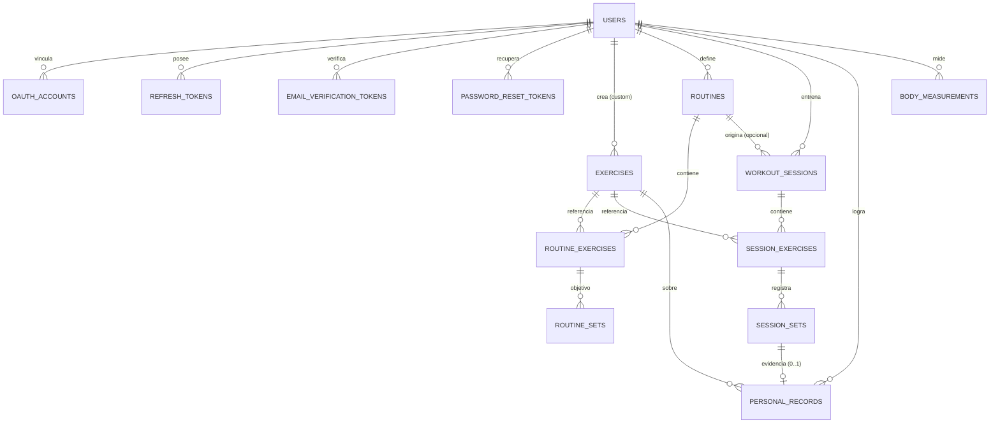

# 05 · Modelo de datos

| Versión | 1.0 · 2026-11-09 · normativo para las migraciones Flyway (RNF-40) |

## 0 · Convenciones

- Tablas en plural `snake_case`; ids **UUID v7** generados por PostgreSQL 18 (`uuidv7()`)
  — ordenales y sin hotspot de índice.
- Todas las tablas: `created_at timestamptz NOT NULL default now()` y
  `updated_at timestamptz NOT NULL` (actualizado por JPA auditing).
- Todo tiempo en **UTC** (`timestamptz`); la zona del usuario es presentación.
- Sin borrado lógico salvo indicación expresa (`exercises.archived`).
- FKs con `ON DELETE` explícito; el borrado de cuenta (RF-010) es transaccional en cascada.
- Extensiones: `pg_trgm` (búsqueda tolerante), `pgcrypto` si hiciera falta (no previsto).

## 1 · Diagrama ER

## 2 · Tablas

### `users`

| Columna | Tipo | Restricciones |
|---|---|---|
| id | uuid | PK |
| email | citext | NOT NULL UNIQUE (índice único) |
| password_hash | text | NULL si es 100 % OAuth y aún sin contraseña |
| display_name | varchar(80) | NOT NULL |
| status | user_status | NOT NULL (`UNVERIFIED`,`ACTIVE`,`LOCKED`) — login bloqueado si UNVERIFIED >24 h (RN-16) |
| locale | char(2) | NOT NULL (`es`/`en`) |
| unit_system | unit_system | NOT NULL default `KG` |
| theme | theme | NOT NULL default `DARK` |
| time_zone | varchar(64) | NOT NULL default `Europe/Madrid` |
| default_rest_seconds | smallint | NOT NULL default 90, CHECK 15..600 |
| timer_sound | boolean | NOT NULL default true |
| email_weekly_summary | boolean | NOT NULL default false (opt-in RF-066) |
| email_verified_at | timestamptz | NULL |
| health_consent_at | timestamptz | NOT NULL (RGPD art. 9, RF-001.1) |
| failed_login_count / locked_until | smallint / timestamptz | bloqueo progresivo RF-002.2 |
| created_at / updated_at | timestamptz | auditoría |

### `oauth_accounts`

| Columna | Tipo | Restricciones |
|---|---|---|
| id | uuid | PK |
| user_id | uuid | NOT NULL FK users ON DELETE CASCADE |
| provider | oauth_provider | NOT NULL (`GOOGLE`,`GITHUB`) |
| provider_account_id | varchar(255) | NOT NULL |
| email_at_link | citext | email entregado en el momento del link |
| created_at / updated_at | timestamptz | |

UNIQUE `(provider, provider_account_id)` · índice por `user_id`.

### `refresh_tokens`

| Columna | Tipo | Restricciones |
|---|---|---|
| id | uuid | PK |
| user_id | uuid | FK CASCADE |
| token_hash | char(64) | NOT NULL UNIQUE (SHA-256 del refresh opaco) |
| expires_at | timestamptz | NOT NULL |
| revoked_at | timestamptz | NULL si vigente |
| replaced_by_id | uuid | NULL FK self (cadena de rotación RN-15) |
| user_agent_hash / ip_hash | char(64) | telemetría de seguridad sin PII en claro |

### `email_verification_tokens` / `password_reset_tokens`

Misma forma: `id, user_id FK CASCADE, token_hash char(64) UNIQUE, expires_at (24 h /
30 min), used_at NULL, created_at`. Solo una fila activa por usuario (la nueva invalida
la anterior).

### `exercises`

| Columna | Tipo | Restricciones |
|---|---|---|
| id | uuid | PK |
| name_es | varchar(120) | NOT NULL |
| name_en | varchar(120) | NOT NULL |
| muscle_group | muscle_group | NOT NULL (`CHEST`,`BACK`,`SHOULDERS`,`BICEPS`,`TRICEPS`,`QUADS`,`HAMSTRINGS`,`GLUTES`,`ADDUCTORS`,`CALVES`,`CORE`,`FOREARMS`,`NECK`,`FULL_BODY`) |
| secondary_muscles | muscle_group[] | NOT NULL default '{}' |
| equipment | equipment | NOT NULL (`BARBELL`,`DUMBBELL`,`MACHINE`,`CABLE`,`BODYWEIGHT`,`KETTLEBELL`,`BAND`,`OTHER`) |
| mechanics | mechanics | NOT NULL (`COMPOUND`,`ISOLATION`) |
| bodyweight | boolean | NOT NULL default false (RN-13) |
| is_custom | boolean | NOT NULL default false |
| owner_id | uuid | NULL FK users — NULL ⇒ catálogo global |
| archived | boolean | NOT NULL default false (RF-023) |
| created_at / updated_at | timestamptz | |

Índices: `GIN (name_es gin_trgm_ops)` y `GIN (name_en gin_trgm_ops)`;
`(muscle_group)`, `(equipment)`; parcial `(owner_id) WHERE is_custom AND NOT archived`.
CHECK: `is_custom = (owner_id IS NOT NULL)`.

### `routines`

| Columna | Tipo | Restricciones |
|---|---|---|
| id | uuid | PK |
| user_id | uuid | FK CASCADE |
| name | varchar(80) | NOT NULL |
| notes | varchar(500) | NULL |
| created_at / updated_at | timestamptz | |

UNIQUE `(user_id, lower(name))` (409 `ROUTINE_NAME_TAKEN`).

### `routine_exercises`

| Columna | Tipo | Restricciones |
|---|---|---|
| id | uuid | PK |
| routine_id | uuid | FK CASCADE |
| exercise_id | uuid | FK exercises RESTRICT (no se borra un ejercicio usado) |
| position | smallint | NOT NULL ≥ 0 |
| rest_seconds | smallint | NULL ⇒ default del usuario |
| superset_group | smallint | NULL ⇒ no agrupado (RN-10) |
| notes | varchar(500) | NULL |

UNIQUE `(routine_id, position)`.

### `routine_sets` (series objetivo, RN-24)

| Columna | Tipo | Restricciones |
|---|---|---|
| id | uuid | PK |
| routine_exercise_id | uuid | FK CASCADE |
| position | smallint | NOT NULL ≥ 0 |
| set_type | set_type | NOT NULL default `NORMAL` |
| target_reps | smallint | NOT NULL 1..1000 |
| target_weight | numeric(6,2) | NULL (kg, RN-01/02) |
| target_rir | smallint | NULL 0..10 |

UNIQUE `(routine_exercise_id, position)`.

### `workout_sessions`

| Columna | Tipo | Restricciones |
|---|---|---|
| id | uuid | PK |
| user_id | uuid | FK CASCADE |
| routine_id | uuid | NULL FK routines SET NULL (origen opcional) |
| name | varchar(80) | NOT NULL |
| status | session_status | NOT NULL (`ACTIVE`,`FINISHED`,`AUTO_CLOSED`,`DISCARDED`) |
| started_at | timestamptz | NOT NULL |
| finished_at | timestamptz | NULL (NOT NULL si status ≠ ACTIVE) |
| duration_seconds | int | NULL (calculado al cerrar, RN-09 para AUTO_CLOSED) |
| total_volume | numeric(10,2) | NOT NULL default 0 (denormalizado al cerrar; RW: recalculado) |
| notes | varchar(500) | NULL |
| created_at / updated_at | timestamptz | |

Índice parcial UNIQUE `(user_id) WHERE status = 'ACTIVE'` — **la BD garantiza RN-08**.
Índice `(user_id, started_at DESC)`; parcial `(user_id) WHERE status IN ('FINISHED','AUTO_CLOSED')`.

### `session_exercises`

| Columna | Tipo | Restricciones |
|---|---|---|
| id | uuid | PK |
| session_id | uuid | FK CASCADE |
| exercise_id | uuid | FK exercises RESTRICT |
| position | smallint | ≥ 0, UNIQUE `(session_id, position)` |
| rest_seconds | smallint | NULL ⇒ default usuario |
| superset_group | smallint | NULL |
| notes | varchar(500) | NULL |

### `session_sets`

| Columna | Tipo | Restricciones |
|---|---|---|
| id | uuid | PK |
| session_exercise_id | uuid | FK CASCADE |
| position | smallint | ≥ 0, UNIQUE `(session_exercise_id, position)` |
| set_type | set_type | NOT NULL default `NORMAL` |
| reps | smallint | NOT NULL 1..1000 |
| weight | numeric(6,2) | NOT NULL -1000..1000 (kg; negativo = asistencia en bodyweight, RN-13) |
| rir | smallint | NULL 0..10 |
| notes | varchar(500) | NULL |
| logged_at | timestamptz | NOT NULL default now() |
| created_at / updated_at | timestamptz | |

### `session_target_sets` (V7, RN-24)

| Columna | Tipo | Restricciones |
|---|---|---|
| id | uuid | PK |
| session_exercise_id | uuid | FK CASCADE |
| position | smallint | ≥ 0, UNIQUE `(session_exercise_id, position)` |
| set_type | set_type | NOT NULL default `NORMAL` |
| target_reps | smallint | NOT NULL 1..1000 |
| target_weight | numeric(6,2) | NULL (kg sugeridos) |
| target_rir | smallint | NULL 0..10 |

Se copian de `routine_sets` al iniciar una sesión desde rutina. Al registrar la serie real
con `targetSetId`, la fila pendiente se elimina; nunca computa volumen ni PR.

### `personal_records`

| Columna | Tipo | Restricciones |
|---|---|---|
| id | uuid | PK |
| user_id | uuid | FK CASCADE |
| exercise_id | uuid | FK CASCADE |
| pr_type | pr_type | NOT NULL (`MAX_WEIGHT`,`MAX_E1RM`) |
| value | numeric(8,2) | NOT NULL (kg) |
| achieved_at | timestamptz | NOT NULL (fecha de la serie) |
| session_set_id | uuid | NULL FK session_sets SET NULL (evidencia) |
| created_at / updated_at | timestamptz | |

Se guarda **todo el histórico de PRs** (`is_current` implícito = el de mayor value
por `(user, exercise, pr_type)`); el recálculo (RN-05) es idempotente y reinserta
basado en series reales, pudiendo «perder» PRs si se corrigen series a la baja
(comportamiento deseado y testado).

### `body_measurements`

| Columna | Tipo | Restricciones |
|---|---|---|
| id | uuid | PK |
| user_id | uuid | FK CASCADE |
| measured_at | timestamptz | NOT NULL |
| weight | numeric(5,2) | NULL 20..400 (kg) |
| chest / waist / hip / arm / thigh | numeric(5,1) | NULL 10..250 (cm) |
| notes | varchar(500) | NULL |

CHECK: al menos un campo medible NOT NULL (RN-23) · Índice `(user_id, measured_at DESC)`.

### `feature_flags`

| Columna | Tipo | Restricciones |
|---|---|---|
| key | varchar(80) | PK |
| enabled | boolean | NOT NULL |
| description | varchar(200) | NOT NULL |

Valores iniciales: ver RF-082. Solo override global (sin flags por usuario en MVP).

### `event_publication` (Spring Modulith, gestión interna)

Creada por Modulith (event publication registry): publicación transaccional de eventos
de dominio para emails y derivados (outbox de facto — ver ADR-0002 §alternativas).

## 3 · Enums (Postgres `CREATE TYPE` + Java enum espejo)

| Tipo | Valores |
|---|---|
| user_status | `UNVERIFIED`, `ACTIVE`, `LOCKED` |
| oauth_provider | `GOOGLE`, `GITHUB` |
| unit_system | `KG`, `LB` |
| theme | `DARK`, `LIGHT` |
| muscle_group | 14 valores (§ `exercises`) |
| equipment | 8 valores (§ `exercises`) |
| mechanics | `COMPOUND`, `ISOLATION` |
| set_type | `WARMUP`, `NORMAL`, `FAILURE`, `DROP` |
| muscle_group | `CHEST`, `BACK`, `SHOULDERS`, `BICEPS`, `TRICEPS`, `QUADS`, `HAMSTRINGS`, `GLUTES`, `ADDUCTORS`, `CALVES`, `CORE`, `FOREARMS`, `NECK`, `FULL_BODY` |
| session_status | `ACTIVE`, `FINISHED`, `AUTO_CLOSED`, `DISCARDED` |
| pr_type | `MAX_WEIGHT`, `MAX_E1RM` |

## 4 · Migraciones Flyway previstas

| V | Contenido |
|---|---|
| V1 | extensiones (`pg_trgm`), tipos enum, tablas `identity` |
| V2 | tablas `catalog` (sin seed) |
| V3 | tablas `training` (sesiones + rutinas) |
| V4 | tablas `progress` y `body` |
| V5 | `feature_flags` + seeds de flags |
| V6 | seed del catálogo (~200 ejercicios, `docs/seed-ejercicios.csv`) |
| V7 | `session_target_sets`: series objetivo pendientes al iniciar desde rutina (RN-24) |
| V8 | `users.email_weekly_summary`: opt-in del resumen semanal |
| V9 | enum `muscle_group`: añade `ADDUCTORS` |
| V10 | reclasifica la aducción de cadera como `ADDUCTORS` |
| (runtime) | cuenta demo + 12 semanas sintéticas con `FERRO_DEMO_ENABLED=true` |

## 5 · Seed del catálogo (~200 ejercicios)

- Fuente: lista curada manual en `docs/seed-ejercicios.csv` (se redacta en M2) con
  columnas `name_es,name_en,muscle_group,secondary,equipment,mechanics,bodyweight`.
- Cobertura mínima garantizada: press banca plano/inclinado/militar, sentadilla
  alta/front, peso muerto convencional/rumano, hip thrust, dominadas, jalones,
  remos, face pull, aperturas, curl bíceps barra/mancuerna/martillo, extensiones y
  press francés de tríceps, elevaciones laterales/frontales, gemelos, core (plancha,
  rueda), híbridos (thruster, clean & press) ≈ referencia PPL/upper-lower.
- Validación del CSV en CI (schema + unicidad de nombres + grupos válidos).

## 6 · Decisiones de datos notables

1. **Denormalización mínima**: `total_volume` en `workout_sessions` (recalculado en
   escritura) para listados sin agregaciones pesadas; el resto se calcula con SQL.
2. **PRs con histórico completo**: barato (pocas filas por usuario) y explica mejor
   el dominio en entrevistas que un único «PR actual».
3. **Sin tablas de auditoría genérica**: los eventos de negocio relevantes quedan en
   `event_publication` y los de seguridad en logs (RNF-24); una tabla audit genérica
   sería ceremonia sin consumidor.
4. **uuidv7 en BD**: evita doble fuente de verdad (app + bd) y simplifica tests.
5. **citext para emails** + normalización NFKC + trim + lowercase en app (única vía
   de entrada).
